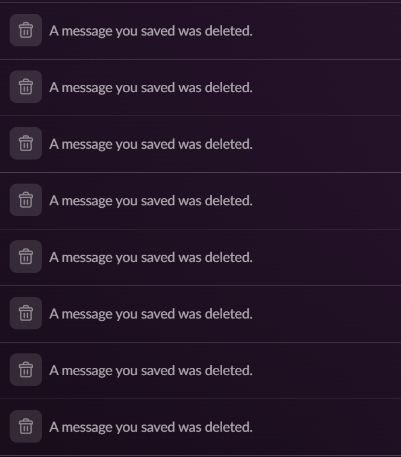
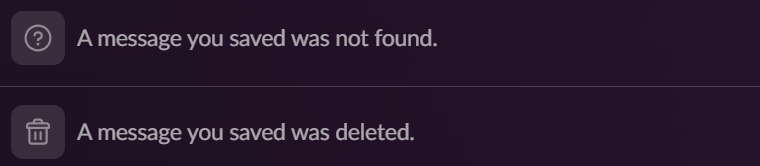
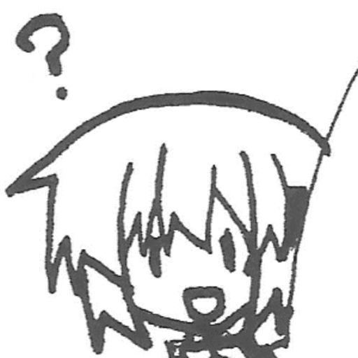

# Snapshot
thing in case somone yoinks a slack message

Does this ever happen to you:
You save an interesting looking message for some reason, only to be later confronted by this?

Well fear not; introducing SnapShot! 

With SnapShot, you are now able to be notified if such cases happen, and will satisfy your itch to know what mysterious messages were obliterated from your view!

Go to [snapshot.ckacha.dev](https://snapshot.ckacha.dev/) and continue there.